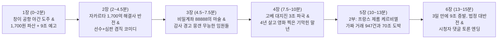

# 🎬 〈머니 아카이브〉 제1화 15분 블록버스터 최종 제작 기획서 (v2.0)

수백만 조회수가 터진 국내외 대박 다큐 11편([viral_outlier_analysis_report.md](file:///C:/Users/이태환/.gemini/antigravity/brain/f21565db-f075-40e3-b2c4-522024860a84/viral_outlier_analysis_report.md))의 흥행 공식을 100% 반영하여 **제목·썸네일·24컷 연출표·15분 풀 대본**까지 전면 업그레이드 완료했습니다! 🔥

---

## 1. 신규 개설 채널 정보

* **채널 이름:** **머니 아카이브** (`@money-archive-kr`)
* **채널 주소:** https://www.youtube.com/@money-archive-kr
* **유튜브 스튜디오:** https://studio.youtube.com/channel/UC2Q7ithCngR3GyV9HfK3u4w


---

## 2. 대박 공식 이식 완료! 제1화 제목 & 썸네일 패키지 (v2.0)

### 🎯 제1화 최종 제목 후보 (아웃라이어 검증 카피)
* **A안 (강력 추천 · 대조 + 스케일 확장형):**
  `233년 영국 왕실 은행을 단돈 1,700원에 파산시킨 28살 고졸 신입.. 그리고 3일 만에 9조를 날린 더 거대한 괴물`
* **B안 (호기심 + 베스트 댓글 분노 자극형):**
  `회사 돈 3조 날리고 "죄송합니다" 쪽지 한 장 남긴 신입 직원.. 은행은 망했는데 혼자 떼돈 번 기막힌 실화`
* **C안 (숫자 타격형):**
  `고작 3천만 원 실수를 숨기려다 3조 증발, 그 뒤엔 70조 도박까지! 전 세계 은행을 공포에 떨게 한 최악의 직원들`

### 🖼️ 썸네일 구성안 v2.0 ('해맑은 미소의 아이러니' 공식 적용!)
* **비주얼 핵심 변경:** 괴로워하는 뒷모습 대신, 실제 66만~426만 뷰 대박 영상들의 공통점인 **화려한 줄무늬 트레이딩 재킷을 입고 자신만만하게 미소 짓는 젊은 트레이더 클로즈업** + 등 뒤로 무너지는 왕실 은행과 시뻘건 `-9조 원 / £1 파산` 수직 폭락 차트 합성!
* **썸네일 텍스트 (최대 2줄 + 상단 해시태그 배지):**
  * 좌상단 작은 노란 배지: `#역대최악_금융사고`
  * 메인 카피: `233년 왕실 은행 박살 낸` / `28살 고졸 신입의 최후`
* **AI 이미지 생성 프롬프트:**
  `High-CTR YouTube documentary thumbnail, close-up portrait of a confident smiling 28-year-old British trader in the 1990s wearing a bright yellow and navy striped SIMEX trading jacket on the left, contrasted against a dramatic dark background showing a massive glowing red stock market crash line plunging straight down and a grand historic London stone bank crumbling in flames on the right, high contrast, sharp studio lighting, 8k photorealistic --ar 16:9`

---

## 3. 15분 2단 블록버스터 구성 & 20컷 연출 설계도

중간 광고(미드롤)를 **4분 30초 / 9분 00초 / 12분 30초** 구간에 자연스럽게 3번 넣을 수 있도록 설계된 **6장 구성(총 14~15분)**입니다!



| 파트 | 핵심 추가 흥행 장치 | 주요 화면 & 파이썬 데이터 카드 구성 |
| :--- | :--- | :--- |
| **1장: 강렬한 오프닝** | 1파운드 파산 + 13년 뒤 9조 증발 예고 (이중 오픈 루프) | 폭우 속 싱가포르 공항 ➔ `"I'm sorry"` 메모 ➔ `£1 (1,700원)` 매각 도장 ➔ `-9조 원` 경고 카드 |
| **2장: 영웅의 탄생** | **[신규 추가]** 자카르타 1,700억 서류 사고 해결 에피소드 | 산더미 같은 종이 증권 더미 속 밤새 일하는 청년 ➔ `프론트(선수) + 백오피스(심판) = 1인 독점` 구조도 |
| **3장: 88888과 눈먼 상사** | **[신규 추가]** 1994년 내부 감사 경고 보고서를 보너스 때문에 뭉갠 임원들 | 도스(DOS) 모니터 `ACCOUNT 88888` ➔ `보고된 가짜 수익(청색↑) vs 숨겨진 적자 -3,500억(적색↓)` 양극화 차트 |
| **4장: 대지진 & 기막힌 말년** | **[신규 추가]** 출소 후 베스트셀러·할리우드 영화·고액 강연자로 잘 사는 블랙 코미디 | 1995 고베 대지진 아카이브 ➔ 본사 자금 `75% 송금` 그래프 ➔ 영화 포스터풍 화려한 강연 무대 대비 |
| **5장: 70조 유령 베팅** | **[2부 확장]** 백오피스 보안팀 출신 제롬 케르비엘의 감시망 해킹 트릭 | 파리 소시에테 제네랄 타워 ➔ `실제 매수 +1조 / 가짜 매도 -1조 = 위험 0% 착시` 해킹 그래픽 ➔ `총 판돈 70조 원` 카운트업 |
| **6장: 9조 증발 & 대반전** | **[댓글 폭발 장치]** 74번의 경고 무시 폭로 & 7조 배상 파기 반전 + 시청자 질문 | 3일간의 투매 폭락 차트(`-9조 원 기네스 기록`) ➔ 프랑스 법정 의사봉 ➔ `"진짜 주범은 직원일까, 눈감아준 임원들일까?"` 엔딩 카드 |

---

## 4. 즉시 제작 준비 완료 파일 및 업로드 설명란

* 📁 **본편 15분 풀 대본 (v2.0 반영 완료):** [script_longform_kr.txt](file:///c:/Users/이태환/OneDrive/Desktop/롱폼유투브/money-archive-studio/ep01_barings_kr/script_longform_kr.txt)
* 📁 **60초 쇼츠 유입 대본 (v2.0 반영 완료):** [script_shorts_kr.txt](file:///c:/Users/이태환/OneDrive/Desktop/롱폼유투브/money-archive-studio/ep01_barings_kr/script_shorts_kr.txt)
* 🐍 **음성(MP3) + 자막(SRT) 생성기:** [generate_voice_and_srt.py](file:///c:/Users/이태환/OneDrive/Desktop/롱폼유투브/money-archive-studio/generate_voice_and_srt.py)

### 📋 유튜브 설명란 & 챕터 (그대로 복사해서 사용)
```text
고작 3,000만 원의 실수를 숨기기 위해 만든 비밀 계좌 '88888'로 233년 역사의 영국 왕실 은행을 단돈 1,700원에 파산시킨 스물여덟 살 청년 닉 리슨.
그리고 13년 뒤, 최첨단 은행 보안 시스템을 비웃으며 혼자 70조 원을 베팅해 단 3일 만에 최대 9조 원을 증발시킨 프랑스의 제롬 케르비엘까지!
과연 천문학적인 재앙을 부른 진짜 주범은 선을 넘은 평직원이었을까요, 아니면 돈에 눈이 멀어 경고를 묵살한 경영진이었을까요?

📌 타임라인
00:00 싱가포르 공항 야간 도주와 "죄송합니다" 메모 한 장
01:45 수학 낙제생 고졸 신입이 영국 귀족 은행의 총애를 받은 반전 이유
03:30 선수에게 심판 호루라기를 쥐여준 본사, 그리고 비밀계좌 '88888'
05:40 감사팀의 경고까지 뭉개버린 임원들의 탐욕과 3,500억의 구덩이
07:35 1995년 고베 대지진 직격탄, 그리고 허탈할 정도로 평온한 그의 말년?!
09:45 [2부] 13년 뒤 프랑스, 닉 리슨을 뛰어넘은 사상 최악의 괴물 등장
11:20 은행 감시 컴퓨터를 바보로 만든 947번의 유령 거래와 70조 원의 도박
13:05 단 3일 만에 9조 원 증발! 그리고 법정에서 터진 충격적인 대반전

#기업몰락 #금융실화 #베어링스은행 #닉리슨 #제롬케르비엘 #경제다큐 #머니아카이브
```
